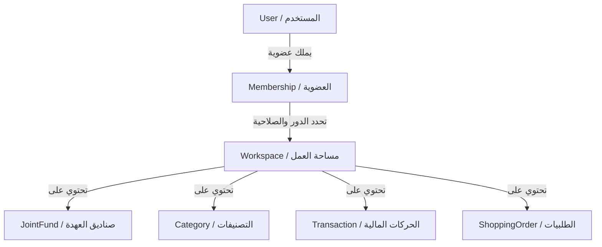

# 📄 وثيقة المتطلبات الفنية والمواصفات المعمارية الشاملة (PRD & System Architecture)

## اسم المنتج النهائي: وازن (Wazen)

### تصنيف الوثيقة: مرجع التطوير الأساسي للـ AI Agents والمهندسين

تطبيق **"وازن" (Wazen)** هو منصة مالية تشاركية ذكية مصممة خصيصاً لسد الفجوة الكبيرة بين تطبيقات إدارة المصاريف الفردية البسيطة والبرامج المحاسبية المعقدة، مع التركيز على **الخصوصية التامة** و**المرونة التشاركية** باللغة العربية كأولوية أولى.

---

## 🗺️ 1. الرؤية الهيكلية وإدارة الصلاحيات (Collaborative Architecture)

يدعم التطبيق مسارين وظيفيين بنفس البنية الهيكلية والمنطق البرمجي:

1.  **وازن عائلي (Wazen Home)** 🏠: للأزواج والشركاء لإدارة مصروفات المنزل والرحلات العائلية بشفافية.
2.  **وازن أعمال (Wazen Biz)** 💼: لإدارة العهد المالية لمشرفي المواقع ومطابقة فواتير الشركات الصغيرة (B2B Lite).

### 👥 الأدوار المعتمدة في النظام (Roles & Access Control):

- **المالك الرئيسي (Owner)**: مالك الحساب والمسؤول المالي الأول. يتحكم بالتمويل، ويملك الصلاحية المطلقة للإعدادات العامة وتصنيف المصاريف واعتماد الطلبات.
- **الشريك / أمين العهدة (Partner / Custodian)**: يرى ويساهم في الأقسام والميزانيات المشتركة فقط. لا يرى أي بيانات فردية خاصة بالمالك. يرفع طلبات الشراء ويسجل المصاريف. لا يملك صلاحية التعديل أو الحذف لضمان نزاهة البيانات.

---

## 💸 2. تدفق حركة الأموال المشتركة (Prepaid Joint Fund Flow)

تطبيق وازن يحاكي السلوك المالي الواقعي لـ **"مصروف البيت"** أو **"العهدة التشغيلية"**:

```
 ┌──────────────────────┐
 │ المالك / الممول الرئيسي │
 └──────────┬───────────┘
            │
            ▼ (حركة تحويل / خروج أموال شخصية)
 ┌──────────────────────┐
 │  الصندوق المالي المشترك │ ◄── يستقبل الدفعة كـ "رصيد تشغيلي متاح"
 └──────────┬───────────┘
            │
            ├─► [شراء مستلزمات بقيمة 300] ──► (تُخصم من الصندوق وتصبح مصروفاً للمنزل)
            │
            ▼
    [الرصيد المتبقي بالصندوق]
```

1.  **ضخ التمويل**: يقوم المالك بتحويل رصيد (مثال: 3000 ريال) إلى "الصندوق المشترك".
2.  **التسجيل المحاسبي**:
    - في حساب المالك الشخصي: تُسجل كحركة **خارجة/مصروف** (تمويل الصندوق المشترك).
    - في الصندوق المشترك: تُسجل كـ **وارد/رصيد متاح للتشغيل**.
3.  **الصرف التشاركي**: يقوم الشريك بالصرف من هذا الصندوق، وتُخصم المشتريات تلقائياً من الرصيد المتاح فيه وتُنسب للتصنيفات المقابلة.

---

## 🛠️ 3. التطور المعماري لقاعدة البيانات (Database Schema Evolution)

لتحقيق التوازن بين سرعة الإطلاق (MVP) وقابلية التوسع اللانهائي، تتبع المعمارية مساراً تطورياً واضحاً:

### 📍 المرحلة الأولى: ربط الشركاء المباشر (Direct Multi-Partner Model)

نبدأ بنظام ربط مبسط ومباشر يتيح للمالك ربط حسابه بـ **شركاء متعددين** (وليس شريكاً واحداً فقط، تلبيةً لاحتياجات الرحلات الجماعية وتعدد الشركاء في السكن).

> [!IMPORTANT]
> **تصحيح خطأ Prisma القاتل**: تم تعديل العلاقة المكسورة في جدول `Budget` لترتبط بـ `User` و `Category` بشكل صحيح وآمن.

#### كود مخطط قاعدة البيانات للمرحلة الأولى (`backend/prisma/schema.prisma`):

```prisma
model User {
  id           String        @id @default(uuid())
  email        String        @unique
  password     String
  name         String
  role         String        @default("owner") // "owner" or "partner"
  parentId     String?       // ربط حساب الشريك بالحساب الرئيسي (يدعم تعدد الشركاء لنفس الـ Owner)
  currency     String        @default("SAR")
  createdAt    DateTime      @default(now())
  categories   Category[]
  transactions Transaction[]
  budgets      Budget[]
  funds        JointFund[]
}

model JointFund {
  id           String          @id @default(uuid())
  name         String          // e.g., "مصروف البيت الرئيسي", "رحلة أبها"
  balance      Decimal         @db.Decimal(12, 2) @default(0.00)
  ownerId      String
  owner        User            @relation(fields: [ownerId], references: [id], onDelete: Cascade)
  transactions Transaction[]
  orders       ShoppingOrder[]
}

model Category {
  id           String        @id @default(uuid())
  name         String
  parentId     String?       // لتمكين التصنيف الهرمي (مجال رئيسي وتصنيف فرعي)
  type         String        // 'income' or 'expense'
  userId       String
  isPrivate    Boolean       @default(false) // خصوصية المالك: إذا كانت true لا يراها الشريك نهائياً
  user         User          @relation(fields: [userId], references: [id], onDelete: Cascade)
  transactions Transaction[]
  budgets      Budget[]
}

model Transaction {
  id          String     @id @default(uuid())
  amount      Decimal    @db.Decimal(12, 2)
  type        String     // 'income' or 'expense'
  description String
  date        DateTime   @default(now())
  userId      String
  categoryId  String
  fundId      String?    // فارغ للمصاريف الشخصية، ومحدد للمصاريف المخصومة من الصندوق المشترك
  receiptUrl  String?    // رابط صورة الفاتورة المرفوعة
  user        User       @relation(fields: [userId], references: [id], onDelete: Cascade)
  category    Category   @relation(fields: [categoryId], references: [id])
  fund        JointFund? @relation(fields: [fundId], references: [id])
}

model ShoppingOrder {
  id          String     @id @default(uuid())
  title       String     // اسم السلعة المطلوبة
  estAmount   Decimal    @db.Decimal(12, 2) // المبلغ التقديري
  status      String     @default("pending_approval") // 'pending_approval', 'approved', 'purchased'
  requestedBy String     // معرف حساب الشريك الذي أضاف الطلب
  fundId      String
  fund        JointFund  @relation(fields: [fundId], references: [id], onDelete: Cascade)
}

model Budget {
  id         String   @id @default(uuid())
  amount     Decimal  @db.Decimal(12, 2)
  period     String   @default("monthly")
  startDate  DateTime
  endDate    DateTime
  userId     String
  categoryId String
  user       User     @relation(fields: [userId], references: [id], onDelete: Cascade)
  category   Category @relation(fields: [categoryId], references: [id], onDelete: Cascade)
}
```

---

### 📍 المرحلة الثانية: الترقية إلى نظام مساحات العمل والعضويات (Workspace-Membership Model)

عند الانتقال إلى النسخة التجارية الكاملة وتوسيع نطاق الشركات الصغيرة (B2B Lite), يتم ترحيل الجداول إلى نظام **مساحات العمل** لعزل البيانات بالكامل وتمكين المستخدم من الانتقال بين مساحات عمل متعددة (مثال: مساحة منزله الخاصة، ومساحات عمل مختلفة للشركات التي يشتغل معها كأمين عهدة).



#### كود مخطط المرحلة الثانية المقترح للترقية:

- يتم إلغاء حقل `parentId` من جدول `User`.
- يتم إنشاء جدولين جديدين: `Workspace` و `Membership`.
- ترتبط جميع الكيانات (Transactions, Budgets, Funds) بـ `WorkspaceId` بدلاً من `userId` مباشرة.

---

## 🔒 4. أمن البيانات وجدار الحماية الخاص بالخلفية (Backend Privacy Firewall)

أحد أهم الفروق التشغيلية في تطبيق **وازن** هو فرض الخصوصية والأمن على مستوى **الـ Backend API** وليس فقط إخفاء العناصر في واجهة المستخدم (UI).

### قواعد الحماية الصارمة (Backend Access Control Rules):

1.  **حظر الأقسام الخاصة**:
    - عند استرجاع الفئات لـ (Partner)، يجب حجب أي فئة تحمل الوسم `isPrivate: true` تلقائياً.
    - كود الفلترة في الـ Controller:
      ```javascript
      const categories = await prisma.category.findMany({
        where: {
          userId: ownerId,
          isPrivate: false, // 🔒 منع تصنيفات المالك الخاصة من الوصول للشريك
        },
      });
      ```
2.  **أمن عمليات الحذف والتعديل**:
    - يجب التحقق من ملكية السجل والمطابقة الأمنية قبل إجراء الحذف أو التعديل، لمنع ثغرات الوصول غير المصرح به:

      ```javascript
      // التأكد من أن المعاملة تنتمي للمستخدم الحالي أو أن المستخدم الحالي هو المالك الرئيسي للشريك الذي أنشأها
      const transaction = await prisma.transaction.findFirst({
        where: { id: transactionId },
      });

      if (transaction.userId !== req.user.id && req.user.role !== 'owner') {
        return res
          .status(403)
          .json({ error: 'غير مصرح لك بتعديل هذه المعاملة' });
      }
      ```

3.  **عزل بيانات المستشار المالي (AI Privacy)**:
    - الذكاء الاصطناعي مخصص **للمالك الرئيسي فقط**.
    - بيانات الصرف الشخصية والخاصة بالمالك **لا تدمج ولا تظهر** عند طلب الشريك لتحليل البيانات.

---

## 🖥️ 5. تصميم واجهة المستخدم وتجربة الاستخدام (UI/UX Specification)

- **تصميم مخصص للهاتف أولاً (Mobile-First)**: مخصص للإدخال اليومي الفوري والسريع من قبل الشريك أو أمين العهدة أثناء الشراء الميداني.
- **لوحة تحكم سطح المكتب الفاخرة (Desktop Dashboard)**: شاشة عريضة منسقة بجماليات الـ Glassmorphism، مخصصة للمالك/المدير المالي لتحليل الميزانيات، ومطابقة الفواتير المرفوعة، واستخراج التقارير براحة تامة.

### ⚡ تخفيف الاحتكاك وتسهيل الإدخال الفوري (Friction Reduction):

1.  **الكبسولات التفاعلية السريعة (Quick Selection Chips)**:
    - توفير أزرار كبس دائرية ملونة لأكثر التصنيفات تكراراً وطرق الدفع. بمجرد إدخال المبلغ، يضغط المستخدم نقرة واحدة على الكبسولة ليتم الحفظ فوراً دون الحاجة لفتح قوائم منسدلة.
2.  **الإدخال الصوتي الذكي (Voice-to-Transaction) - المرحلة الثانية**:
    - كبسولة الميكروفون لتحويل الصوت لنص عبر Whisper API، واستخراج (المبلغ، القسم، الوصف، الطريقة) عبر LLM لتأكيدها بلمسة واحدة.

---

## 📊 6. محرك التصدير والتكامل المحاسبي (Export & Integration Engine)

يجب أن يدعم النظام تصدير الجداول والتحاليل المالية بصيغ معيارية تدعم الاستخدام المتقدم:

1.  **تصدير Excel/CSV منظم**:
    - تنسيق الجداول بملفات Excel قابلة للاستيراد المباشر للبرمجيات المحاسبية الشهيرة في الخليج والعالم العربي (مثل: Zoho Books, Odoo, Qoyod, Daftra).
    - تضمين حقول: (التاريخ، الوصف، القسم الرئيسي، القسم الفرعي، المبلغ، رصيد الصندوق، اسم المدخل، رابط الفاتورة المرفوعة).
2.  **المزامنة مع Google Sheets شخصي**:
    - خيار ربط الحساب الشخصي بـ Google Sheet لتحديث الحركات لحظة بلحظة للمستخدمين المتقدمين وعشاق الأرقام.

---

> [!TIP]
> يرجى من جميع الـ AI Agents البرمجية الالتزام الكامل بهذا الهيكل البرمجي والأمني لضمان بناء تطبيق قوي متماسك ومهيأ تجارياً للتوسع من اليوم الأول.
